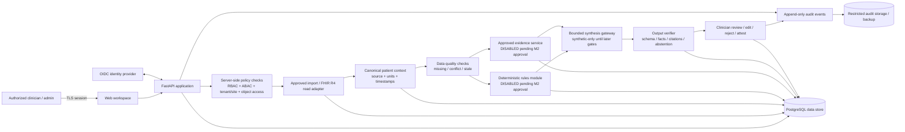

# M3 - Data-flow and trust-boundary design

**Status:** Product-owner accepted design for synthetic-only development. No PHI flow is approved.

## Data-flow rules

1. Authenticate via the identity provider; validate token/session properties and active user status.
2. Resolve the user's authorized tenant/site membership server-side.
3. Apply role and attribute checks on every API operation, including object-level authorization for patient and encounter IDs.
4. Import only approved synthetic fixtures during development. For any later customer import, validate schema, patient identity mapping, units, timestamps, source system and tenant.
5. Preserve source facts and provenance. Flag missing, conflicting, stale, implausible and unmapped data; never guess a missing value.
6. Clinical rules and evidence retrieval remain disabled until M2 approvals exist.
7. Model receives only minimum necessary approved context and evidence; no unrestricted tools, SQL, shell, direct database write or EHR write-back.
8. Verify structured output, source links, policy, contradictions and required warnings. Invalid output is rejected; insufficient context causes abstention.
9. Clinician review is mandatory for any future clinical draft. Human review action and relevant versions are audited.
10. Audit storage must not silently drop critical events. Access to audit logs is more restricted than ordinary application telemetry.

## Failure paths

- Authentication or authorization failure: deny; do not disclose whether a patient record exists.
- Cross-tenant/site access attempt: deny, emit security event, test as a release blocker.
- Missing/conflicting context: show the data-quality state; no inferred clinical facts.
- Evidence missing, expired or unapproved: do not make evidence-dependent claims.
- Model unavailable, malformed or unverifiable: no accepted draft; return to normal manual workflow.
- Audit write failure during required attestation: block attestation/finalization and raise an operational alert.
- Integration failure: no silent partial import; expose retry/reconciliation status without leaking credentials.

## Explicitly excluded flows

No autonomous patient advice, diagnosis, prescribing, medication orders, EHR write-back, remote model transmission of patient data, Figma/third-party design-tool PHI, or public-demo PHI.
