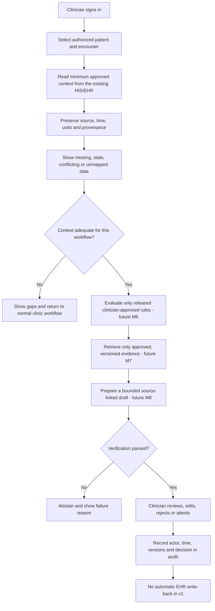

# Workflow map - M1 draft

**Important:** The PDF requires mapping the process as it exists at one target clinic. No target clinic or clinician walkthrough has yet been supplied. Therefore the diagram below is a **proposed product workflow for validation**, not a factual map of a real clinic's current process.

## A. Current-state clinic workflow - evidence to collect

| Field | To be completed during target-clinic walkthrough |
|---|---|
| Clinic/site and jurisdiction | TBD |
| Walkthrough date and participant roles | TBD |
| Patient arrival / registration step | TBD - do not assume |
| Existing patient identification method | TBD |
| Existing HIS/EHR and system of record | TBD |
| Who records blood pressure / observations and how | TBD |
| What context the clinician actually reviews | TBD |
| Existing review, documentation and handoff steps | TBD |
| Follow-up scheduling / ownership | TBD |
| Current failure, delay or rework points | TBD - evidence required |
| Baseline measures and collection method | TBD - collect before claiming improvement |

## B. Proposed assisted workflow - not yet clinically approved

## Handoff and failure rules

- The clinician remains the decision-maker and record owner.
- Missing or conflicting context is displayed, not silently resolved.
- If a source is unavailable/expired, verification fails, or audit cannot be recorded, the draft is not accepted; the user returns to the clinic's existing workflow.
- No autonomous diagnosis, prescription, medicine change, patient message or silent chart finalization.
- Patient search is limited to an authorized tenant/site and clinician relationship; no unrestricted symptom/disease lookup.

## Workflow walkthrough record

- Target clinic: **not supplied**.
- Qualified clinician: **not identified**.
- Observed current-state process: **not yet collected**.
- Product owner validation: **pending**.
- Clinical reviewer validation: **pending**.

## Product-owner constraints for proposed workflow (2026-11-28)

- The proposed "context adequate?" step is a placeholder for a future clinician-approved requirement. Until a qualified clinician defines and signs the required context, the interface may show missing/unmapped/stale/conflicting data but must not make a clinical sufficiency or safety determination.
- Accept/attest means the clinician records a review decision inside NORTHSTAR. It does not finalize or sign the official record and must not trigger HIS/EHR write-back. v1 remains read-only at the integration boundary.
- This remains a proposed workflow. It is not an observed workflow from a real clinic and must be reconciled with the target site's actual process before M1 can exit.
